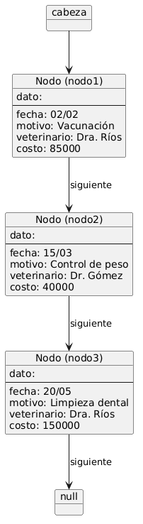

# Patitas — Bitácora Semana 2, Día 1

**Proyecto:** `patitas/` (motor de historial clínico)  
**Tema:** Nodo y recorrido de una lista enlazada.

## Contexto
La directora médica describe el historial como una carpeta donde “cada atención apunta a la siguiente; si alguien saca una hoja, ya no sabemos qué pasó después”. Esa estructura corresponde a una **lista enlazada**. La pieza mínima es el **nodo**.

## Objetivo
Representar atenciones clínicas como nodos enlazados manualmente y recorrerlos de principio a fin sin usar índices ni arreglos.

## Implementación
- `patitas/src/Nodo.js`: clase `Nodo` con propiedades `dato` (objeto de la atención) y `siguiente` (referencia al próximo nodo, inicialmente `null`).
- `patitas/pruebas/nodos.js`: creación de tres nodos con las atenciones de Lola (gata, 4 años), enlace manual en orden cronológico y dos recorridos con `while (actual !== null)`.

**Atenciones (datos):**
1. `{ fecha: "02/02", motivo: "Vacunación", veterinario: "Dra. Ríos", costo: 85000 }`
2. `{ fecha: "15/03", motivo: "Control de peso", veterinario: "Dr. Gómez", costo: 40000 }`
3. `{ fecha: "20/05", motivo: "Limpieza dental", veterinario: "Dra. Ríos", costo: 150000 }`

**Enlaces:**
```js
nodo1.siguiente = nodo2;
nodo2.siguiente = nodo3;
const cabeza = nodo1;
```

## Diagrama de nodos y flechas



Representación compacta:
`cabeza → [02/02 Vacunación, $85000 | •] → [15/03 Control de peso, $40000 | •] → [20/05 Limpieza dental, $150000 | null]`

## Recorridos (sin índices ni arreglos)
1. **Impresión:** `actual = cabeza; while (actual !== null) { imprimir(actual.dato); actual = actual.siguiente; }` → imprime las 3 atenciones en orden.
2. **Costo total:** segundo recorrido acumulando `actual.dato.costo` → **$275.000** (85.000 + 40.000 + 150.000).

Ejecución: `node patitas/pruebas/nodos.js` (o desde `patitas/`: `node pruebas/nodos.js`).

**Salida obtenida:**
```
=== Historial de atenciones (Lola) ===
02/02 - Vacunación - Dra. Ríos - $85000
15/03 - Control de peso - Dr. Gómez - $40000
20/05 - Limpieza dental - Dra. Ríos - $150000

Costo total del historial: $275000
```

## Experimento: enlace perdido
**Cambio realizado (a propósito):** `nodo1.siguiente = null;` (se pierde el enlace del primer nodo al segundo).

**Qué ocurre al recorrer desde `cabeza`:**
- `actual` inicia en `nodo1` (no es `null`), se imprime la primera atención (Vacunación).
- Luego `actual = actual.siguiente` pasa a ser `null` (porque rompimos el enlace).
- La condición `while (actual !== null)` resulta falsa y el ciclo termina.

**Resultado:** solo se visita/imprime la **primera** atención y el costo total calculado sería **$85.000**. Los nodos `nodo2` y `nodo3` siguen existiendo en memoria y aún están enlazados entre sí (`nodo2.siguiente === nodo3`), pero se vuelven **inaccesibles** desde `cabeza`.

**Por qué ocurre:** una lista enlazada no tiene acceso por índice; el único camino para llegar a los demás nodos es seguir la cadena de referencias `siguiente` desde la cabeza. Al asignar `null` al `siguiente` del primer nodo se corta esa cadena, por lo que el recorrido no tiene forma de “saltar” al resto del historial. Esto ilustra la fragilidad señalada: perder un enlace equivale a perder el acceso a todo lo que viene después.
